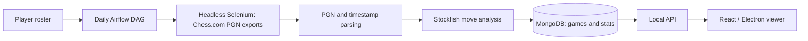

# BauChess

A chess-club game review system that turns recent Chess.com games into Stockfish analysis and player statistics. An Apache Airflow DAG runs the collection, analysis, and database loading once a day. A React dashboard lets players inspect games, move evaluations, and time spent on each move.

[Repository](https://github.com/metinegearal/BauChess) · [Daily automation](Dags/airflowTry.py)

## How it works



For each configured player, `BauChess_Scrap_to_DB` runs three tasks:

1. **Extract:** open the player's archive in headless Chrome and export up to ten games, including timestamps. A configurable date cutoff can stop collection early.
2. **Process:** parse the PGNs, calculate move times, evaluate moves with Stockfish, and produce opening, phase, and move-quality summaries.
3. **Load:** upsert the game reviews and player statistics into MongoDB. Stable game IDs and unique indexes prevent repeated scheduled runs or task retries from duplicating these records.

Tasks retry up to three times, five minutes apart. Extraction errors propagate to Airflow, and the browser closes on success, failure, and date-cutoff exits. Airflow must remain running for the schedule to execute; closing the dashboard does not stop it.

This is a local prototype. It scans the latest archive page rather than importing a player's full history. The optional Ollama helper is an experiment and is **not** called by the daily DAG.

## Requirements

- Linux/macOS, or Linux through WSL on Windows.
- Python 3.12 or 3.13. The scheduler targets Apache Airflow **3.1.0**.
- Node.js 22.12+ and npm for the React/Electron viewer.
- MongoDB running locally or a configured Atlas database.
- A Stockfish executable and Chrome/Chromium with a compatible ChromeDriver.

Stockfish, Chrome, MongoDB, and model weights are installed separately. Do not commit executables or credentials.

## Set up the project

```bash
git clone https://github.com/metinegearal/BauChess.git
cd BauChess
python3 -m venv .venv
source .venv/bin/activate
python -m pip install -r requirements.txt
cp .env.example .env
cp people.example.txt people.txt
```

Edit `people.txt` to contain your players' Chess.com usernames, one per line. Blank lines and lines beginning with `#` are ignored. Replace the example username before scraping.

Edit `.env` for your machine. All Python components read it automatically; the Node backend reads the same root file. Environment variables already set by the host take precedence.

| Setting | Purpose |
| --- | --- |
| `MONGODB_URI` | MongoDB connection URI; default `mongodb://127.0.0.1:27017` |
| `MONGODB_DATABASE` | Database shared by the pipeline and viewer; default `chessDB` |
| `STOCKFISH_PATH` | Executable name on `PATH`, or an absolute path |
| `STOCKFISH_DEPTH` | Pipeline search depth; default 12 |
| `STOCKFISH_THREADS`, `STOCKFISH_HASH_MB` | Pipeline engine resources; defaults 2 threads and 128 MB |
| `CHROMEDRIVER_PATH` | ChromeDriver path; unset to let Selenium locate/manage a driver |
| `CHROME_BINARY` | Optional Chrome/Chromium executable path |
| `SCRAPE_AFTER_DATE` | Optional `YYYY-MM-DD` cutoff; skip games on or before that day |
| `PEOPLE_FILE`, `PGN_DATA_DIR`, `OPENINGS_CSV` | Roster, collected exports, and opening lookup; relative to repository root |
| `VITE_API_URL` | Viewer API URL; default `http://127.0.0.1:8000`; restart/rebuild the viewer after changes |
| `OLLAMA_URL`, `OLLAMA_MODEL` | Optional LLM helper configuration |

To collect the latest games once, with MongoDB loading left to the scheduled pipeline:

```bash
python ScrapChessData.py
```

Exports are saved as `PgnData/pgn_data_YYYY-MM-DD_USERNAME.txt`, using the collection date. The stored game record uses the game date from the PGN. Raw exports use ` ***TimeStamp*** ` between the normal and timestamped copies and ` ***Space*** ` between games.

## Run the daily automation

From the repository root, with the virtual environment activated:

```bash
export AIRFLOW_HOME="$PWD/airflow"
BAUCHESS_PYTHON_VERSION="$(python -c 'import sys; print(f"{sys.version_info.major}.{sys.version_info.minor}")')"
python -m pip install -r requirements-airflow.txt \
  --constraint "https://raw.githubusercontent.com/apache/airflow/constraints-3.1.0/constraints-${BAUCHESS_PYTHON_VERSION}.txt"
python -m pip install -r requirements.txt "apache-airflow==3.1.0"
python -m pip check

export AIRFLOW__CORE__DAGS_FOLDER="$PWD/Dags"
export AIRFLOW__CORE__LOAD_EXAMPLES=False
export PYTHONPATH="$PWD${PYTHONPATH:+:$PYTHONPATH}"
airflow standalone
```

The two installation steps follow Airflow's [versioned installation guidance](https://airflow.apache.org/docs/apache-airflow/3.1.0/installation/installing-from-pypi.html): install Airflow with its matching constraints, then install application dependencies while retaining the Airflow pin.

Open `http://localhost:8080`, sign in using the credentials printed by Airflow, and unpause **BauChess_Scrap_to_DB**. Trigger it manually to verify your configuration, then leave Airflow running for the daily schedule. See the [Airflow quick start](https://airflow.apache.org/docs/apache-airflow/3.1.0/start.html) for standalone setup details.

The DAG creates one extract/process/load group per player. A missing roster produces no player tasks. Keep the repository available at the same path, and provide its configuration, browser, engine, and Python modules to every worker if moving beyond a single-machine setup.

## Run the dashboard

Start the Node API in one terminal:

```bash
cd my-app
npm ci
npm run backend
```

In another terminal:

```bash
cd my-app
npm run dev
```

Open `http://localhost:5173`. Choose or type a username, select the **game date**, and choose a game index starting at 0. Use the arrow keys or A/D to step through moves, or click chart points. The database must contain processed games for that player/date. The API reads engine configuration from the host; HTTP clients cannot choose an executable.

For the local Electron viewer, stop the separately running Node API first, then run:

```bash
cd my-app
npm run build
npm run desktop
```

Electron starts its own API process. The desktop command is intended for running from this checkout; distributable installers have not been validated.

Two Python alternatives are also included. Use only **one API** on port 8000:

```bash
# From repository root, with the virtual environment active:
python -m uvicorn BackEnd.server:app --host 127.0.0.1 --port 8000
# Optional Streamlit reports using raw exports and MongoDB statistics:
python -m streamlit run FrontEnd.py
```

The Node API binds to loopback and exposes:

| Endpoint | Input / result |
| --- | --- |
| `GET /users` | Roster usernames, or usernames from stored games if no roster exists |
| `POST /chart` | `{ "user": "player", "date": "2025-10-03", "num": 0 }`; returns one game review or HTTP 404 |
| `POST /eval` | `{ "fen": "..." }`; returns a Stockfish score from White's perspective |

## Repository layout

```text
Dags/airflowTry.py       Daily Airflow TaskFlow DAG
ScrapChessData.py        Headless browser extraction
DataProcess.py          PGN parsing, timestamps, stable game IDs
StockFishReview.py      Engine evaluations and review summaries
ChessTools.py           Opening lookup and heuristic quality metrics
DataStorage.py          Retry-safe MongoDB upserts
config.py               Shared environment/path configuration
Data/openings.csv       Small opening lookup used at runtime
BackEnd/server.py       Alternative FastAPI server
my-app/                 React, Vite, Node API, and Electron entry point
FrontEnd.py             Optional Streamlit reports
BasicOllama.py          Optional local LLM experiment
scrapClubMembers.py     Optional manual club-roster collection helper
people.example.txt      Public roster template
.env.example            Public configuration template
tests/                  Offline regression tests
.github/workflows/      Python checks and frontend lint/build
```

The root Python modules are the shared implementation for the DAG and API. Earlier duplicate modules have been preserved locally under the ignored `.local-archive/` directory.

`.gitignore` excludes virtual environments, `node_modules`, builds/installers, Airflow state, credentials, private rosters, collected PGNs, the multi-gigabyte training dataset, generated reports, and unrelated board-detection experiments/personal notes. It retains source, dependency lockfiles, templates, tests, and the runtime opening lookup. Ignoring a file does not remove it from existing Git history.

## Checks

```bash
python -m unittest discover -s tests -v
cd my-app
npm run check
```

The regression suite covers timestamp parsing, stable player-specific IDs, games without timestamps, retry-safe writes, browser cleanup on extraction failures, and Black's evaluation perspective. When Airflow is installed, it also checks that two players produce six correctly connected DAG tasks. GitHub Actions runs the Python checks and frontend lint/build on pushes and pull requests.

## Limitations and troubleshooting

- **Missing or moved Chess.com controls:** the scraper scrolls game links into view, waits for controls, and checks two share-button locations. Those selectors depend on Chess.com's UI. Games without the expected timestamp/export controls cause the task to fail and retry; inspect Airflow logs and update the selectors when the site changes. A fully empty archive is also currently treated as an extraction failure.
- **Missed games:** only the latest ten games on the current archive page are collected. Heavy play between runs can exceed that window. There is no persisted extraction watermark; repeat collection is handled through database upserts.
- **Game analysis:** move classifications and accuracy are heuristic, not Chess.com's proprietary scores. Accuracy is a fraction from 0 to 1 based on mean expected-points loss; absent phases have `null` accuracy. Scores from older versions of this project are not directly comparable. Phase boundaries and opening identification use simple rules.
- **No move timestamps:** the game is still analyzed, but its time series is empty and its average time is 0. Partial timestamps appear as gaps.
- **MongoDB index errors on an existing database:** unique indexes require clean `game_id` and `GameID` values. Older runs used a different ID format and could produce duplicates. Back up and inspect old records before migrating; the loader does not delete them. Game and stats writes are separate upserts, so a retry repairs a partial load rather than providing a cross-collection transaction.
- **Local services:** keep the dashboard API local. Authentication, remote multi-user hosting, full-history ingestion, alert delivery, and large XCom payload handling are outside this prototype.
- **External data:** `Data/openings.csv` is the existing runtime lookup. Its upstream source/license is not recorded in this checkout; verify redistribution terms before reusing it elsewhere. Stockfish and other third-party components retain their own licenses.

## Short automation description

> I built BauChess, a daily Airflow pipeline that collected Chess.com games, analyzed them with Stockfish, and stored player statistics in MongoDB without supervision. The fragile part was browser automation: scrolling and missing share/export buttons. I added scrolling, alternate selectors, and retries. Code: [github.com/metinegearal/BauChess](https://github.com/metinegearal/BauChess).
